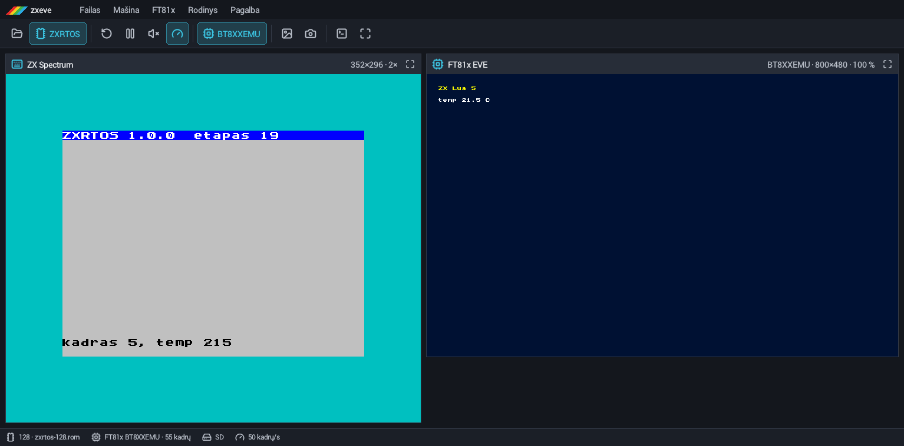

# zxeve

ZX Spectrum 128 emuliatorius Windows sistemai su **FT81x EVE** ekranu
(FT813, 800 × 480): ZX ekranas ir FT81x langas greta, pelė FT81x lange -
lietimas. Skirtas ZXRTOS (FreeRTOS ROM ZX Spectrum 128) FT81x darbui, bet
tinka ir įprastoms ZX programoms bei žaidimams.



Tai **paruošta programa** - nieko kompiliuoti nereikia.

## Paleidimas

1. Atsisiųskite (žalias mygtukas **Code → Download ZIP**) ir išpakuokite
   bet kur, arba `git clone`.
2. Paleiskite **`zxeve.exe`**.

Reikia **Windows 10 / 11 x64**. FT81x su koprocesoriumi (Bridgetek
BT8XXEMU, `system\bt8xxemu.dll`) dar reikia **Microsoft Visual C++
2015-2022 x64 runtime** -
[vc_redist.x64.exe](https://aka.ms/vs/17/release/vc_redist.x64.exe). Be jo
FT81x galima perjungti į paprastesnį imitatorių: mygtukas **BT8XXEMU →
builtin** arba meniu **FT81x → builtin**.

`zxeve-debug.exe` - tas pats, tik su konsole (matyti visas žurnalas).

## Ką galima atidaryti

Meniu **Failas → Atidaryti** (F3) arba tiesiog nutempkite failą į langą:

| Failai | Kas |
|---|---|
| `.tap` `.tzx` | juosta - įsikrauna akimirksniu (ir savi įkėlėjai - ROM LD-BYTES kopijos) |
| `.z80` `.sna` `.szx` | būsenos (snapshot) |
| `.dsk` `.trd` `.scl` | diskai (+3, TR-DOS) |
| `.img` | SD kortelės atvaizdas |

## ZXRTOS

**Mašina → ZXRTOS** (arba mygtukas **ZXRTOS** įrankių juostoje) įkelia
`zxrtos\zxrtos-128.rom` ir SD atvaizdą `zxrtos\zxrtos-sd.img`: ZXRTOS 1.0.0
paleidžia ZX Lua, o AUTORUN.LUA iš karto rodo vaizdą FT81x lange ir groja
AY. Dar kartą paspaudus mygtuką - grįžtama į įprastą ZX Spectrum. Kitas ROM -
**Mašina → Įkelti ROM...**

## Klavišai

| Klavišas | Veiksmas |
|---|---|
| F3 | atidaryti failą |
| F5 | reset |
| F6 | pauzė / tęsti |
| F7 | garsas įjungti / išjungti |
| F9 | tik ZX Spectrum per visą ekraną |
| F10 | tik FT81x EVE per visą ekraną |
| F11 | visa programa per visą ekraną |
| Esc | iš viso ekrano režimo - atgal į langą |

Visa kita klaviatūra - Spectrum'ui (Esc lange - Spectrum EDIT). Pelė FT81x
lange - lietimas (BT8XXEMU).

## Meniu

- **Failas** - atidaryti, ZX ekrano ir FT81x kadro nuotraukos (PNG), išeiti.
- **Mašina** - ZXRTOS / savas / standartinis ROM, reset, pauzė, realus
  laikas, garsas, greitas juostos įkėlimas, modelis: 48K, 128K, +2, +2A, +3,
  Pentagon 128.
- **FT81x** - prijungtas ar ne, BT8XXEMU arba builtin, mastelis.
- **Rodinys** - visas ekranas (visa programa, tik ZX, tik FT81x), ZX
  mastelis, starto efektas, derinimo konsolė.
- **Pagalba → Apie** - visų dalių versijos.

## Nustatymai

`zxeve.conf` šalia `zxeve.exe` (su aprašais): modelis, ROM, FT81x
backend'as, SD atvaizdas, garsas, masteliai ir kt. Programa jį perrašo
baigdama darbą.

Pentagon 128 naudoja Sinclair 128K ROM (`roms\128p-*.rom`). TR-DOS ROM
(`trdos.rom`) nepridėtas - jis nėra laisvai platinamas; savo kopiją įdėkite
į `roms\`.

## Jei kas nors neveikia

- **Nepasileidžia / lūžta** - šalia `zxeve.exe` atsiranda
  `zxeve-start.log` (starto žingsniai, lūžio vieta) ir
  `crashdb\reports\*.dmp` (Crashpad lūžio ataskaita). Juos atsiųskite.
- **FT81x klaida paleidžiant** - įdiekite vc_redist.x64.exe arba
  perjunkite į builtin.
- Žurnalas - `zxeve.log`; plačiau - `zxeve-debug.exe` konsolėje.

## Turinys

```
zxeve.exe, zxeve-debug.exe   programa (be konsolės / su konsole)
zxeve.conf, zlog.conf        nustatymai, žurnalo konfigūracija
system\                      bibliotekos (DLL) ir Crashpad
roms\                        ZX Spectrum ROM'ai
zxrtos\                      ZXRTOS 1.0.0: ROM ir SD atvaizdas
fonts\                       šriftas (Roboto)
LICENSES\                    trečiųjų šalių licencijos
CHANGES.md                   kas naujo
```

## Licencijos

zxeve ir libzxemu - GPL-3.0-or-later, (c) 2026 Donatas. Bridgetek BT8XXEMU
(`system\bt8xxemu.dll`) - Bridgetek nuosavybė, licencija leidžia platinti
kartu su programa (`LICENSES\bt8xxemu-LICENSE.md`). Spectrum ROM'ai - (c)
Amstrad, platinami su jų leidimu (`roms\README.copyright`). Crashpad -
Apache 2.0, Roboto - Apache 2.0, piktogramos - Lucide (ISC), raylib - zlib.
